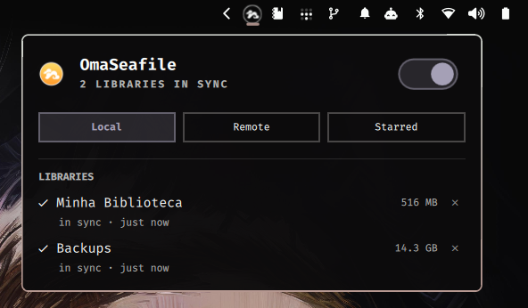

# OmaSeafile

Seafile in the Omarchy bar — **without depending on the desktop client**.



## Install

```sh
omarchy plugin add https://github.com/FelipeMayerDev/omaseafile.git --enable
```

The only requirement is the `seaf-daemon` binary. If it is not on the machine,
the panel offers a button that installs it (`yay -S --needed seafile` on Arch,
which ships the daemon and `seaf-cli`, no GUI).

## Remove

```sh
omarchy plugin remove io.github.felipemayerdev.omaseafile
```

That takes the widget out of the bar and deletes the plugin folder. It leaves
your Seafile data alone, on purpose — removing the plugin is not a reason to
drop synced files or stop the daemon. To clean up the rest yourself:

```sh
rm -rf ~/.config/omarchy/omaseafile   # the API token this plugin stored
seaf-cli stop                          # if you also want the daemon down
```

Your synced libraries in `~/Seafile` and the Seafile packages are untouched.

## The desktop client is optional

OmaSeafile talks straight to `seaf-daemon`'s RPC socket
(`~/Seafile/.seafile-data/seafile.sock`), the same one `seaf-cli` uses. So it
never needs the Seafile applet running — or even installed:

- starts and stops `seaf-daemon` from the switch in the panel, and brings it up
  automatically at login;
- signs into the server and keeps its own API token;
- adds and removes libraries on its own.

If you already use the desktop client, the account configured there is picked
up automatically and nothing changes.

## What it shows

**Local** — synced libraries with live state (in sync, uploading, downloading,
indexing, paused, error), transfer rate, size on disk, downloads in progress
with a percentage, folders inside `~/Seafile` that no library syncs, and
per-file errors.

**Remote** — libraries that exist on the server but do not sync here, with size
and date. The 󰇚 button syncs one right away.

**Starred** — items starred on the server. If the library is already synced the
click opens the local file, otherwise it opens in the browser.

Notifications when a library starts uploading or downloading, when a download
finishes, and when something fails. A red dot on the bar icon marks errors; the
icon pulses during a transfer.

## Controls

- Switch at the top of the panel: start/stop `seaf-daemon`.
- 󰅖 on a local library: stop syncing it (two taps; the files stay on disk).
- Click a row: open the folder/file, or the library on the server.
- Middle click on the bar icon: refresh now.

## Sign in

Server, email and password in the panel. The password is only exchanged for an
API token (`/api2/auth-token/`) and then discarded; the token lives in
`~/.config/omarchy/omaseafile/account.json` with mode 0600.

Encrypted libraries still need the desktop client, for the library password.

## Icon

`seafile.png` is the colored logo, used in the panel. `seafile-mono.png` is the
monochrome mask, tinted at runtime with the theme color through `MultiEffect` —
the same treatment Omarchy's Tray gives symbolic icons. In the bar the icon
follows the theme; in the panel it stays colored.

## Settings

`interval` (local poll, default 10s), `remoteInterval` (server calls, only
while the panel is open), `autostart` (bring the daemon up automatically) and
`notifyTransfers`.

## CLI

`bin/seafile-status` works on its own in a terminal and only needs `python3`:

```sh
seafile-status                 # local state as json
seafile-status --sizes         # plus size on disk
seafile-status --remote        # account, server libraries, starred items
seafile-status --daemon-start | --daemon-stop
seafile-status --login         # {"server","user","password","otp"} on stdin
seafile-status --logout
seafile-status --sync <id> | --desync <id>
seafile-status --clear-errors  # forget recorded file sync errors
seafile-status --install-cmd   # command that installs seaf-daemon
seafile-status --selftest
```

## License

MIT.
